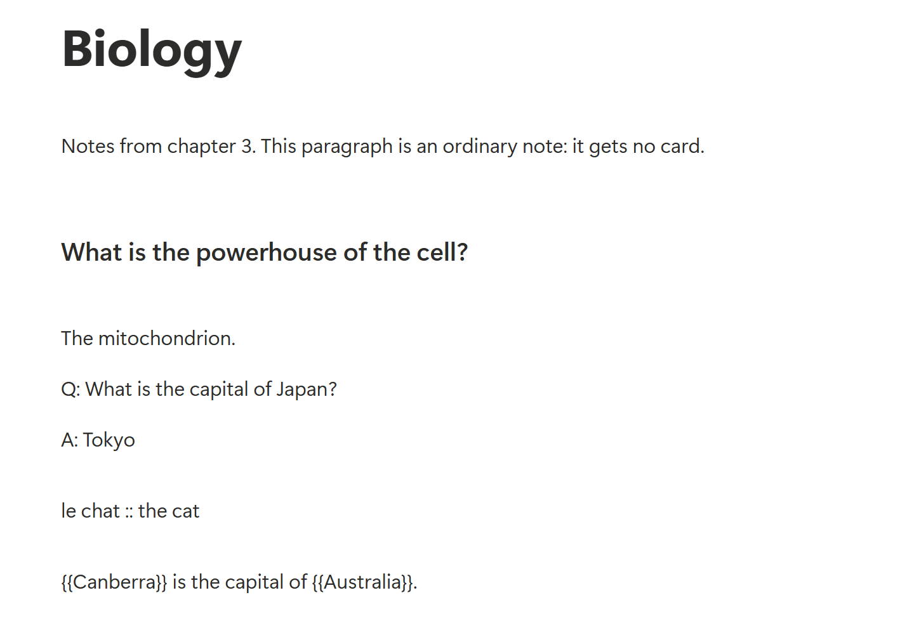
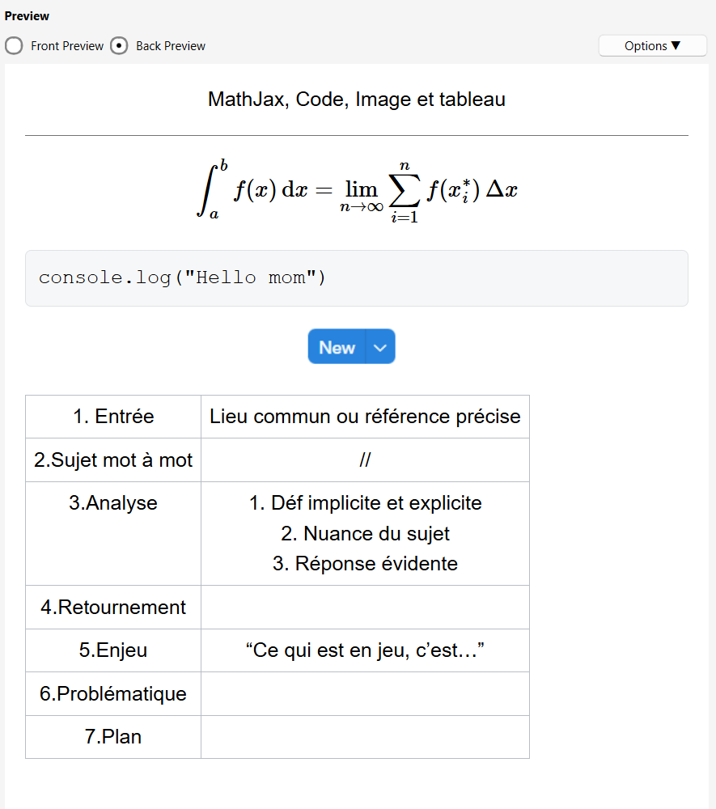
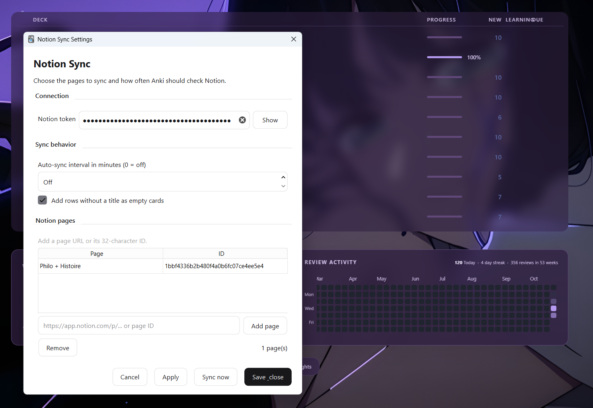

# Notion Sync

Write your notes in [Notion](https://www.notion.so). Get
[Anki](https://apps.ankiweb.net/) flashcards that stay up to date.

You write cards as ordinary text in a Notion page:

```
### What is the powerhouse of the cell?
The mitochondrion.

Q: What is the capital of Japan?
A: Tokyo

le chat :: the cat

{{Canberra}} is the capital of {{Australia}}.
```



Notion Sync reads the page through the official Notion API and makes one
Anki note per card. Edit the text in Notion and the card follows, with its
review history. Delete it in Notion and the card goes. Your own Anki cards
and decks are never touched.

**[Read the guide](docs/guide.md)** for everything you can write.

## What you can write

| In a Notion page | In Anki |
| --- | --- |
| `### Question` with the answer under it | A card |
| `Q: ...` then `A: ...` | A card |
| `front :: back` | A card |
| `{{hidden}}` in a sentence | A cloze card, numbered for you |
| A numbered list under a question | A list you recite item by item |
| A line starting with `Back:` | Everything above it goes on the front |
| `#### Hint` | A collapsed hint on the back |
| ~~struck-through text~~ | An Anki tag |
| A sub-page | A subdeck |
| A table (database) | A subdeck with one card per row |

Math, code with highlighting, images, audio, tables, callouts and columns
are carried over.



## Two ways to run it

**Anki add-on.** Runs inside Anki desktop.

1. Create a Notion integration at <https://www.notion.so/my-integrations>.
2. In Notion, share your pages with it (**... > Connections**).
3. In Anki, open **Tools > Notion Sync > Settings**, paste the token and add
   your pages by their links.
4. **Save & close**, then **Sync now**.



**Hosted.** A small site and a worker keep your AnkiWeb collection current
while Anki is closed. You sign in with Notion and pick the pages. See
[docs/hosted-sync.md](docs/hosted-sync.md).

Both run the same sync code.

## Documentation

| | |
| --- | --- |
| [docs/guide.md](docs/guide.md) | **Start here.** How to write cards, decks, settings, troubleshooting. |
| [notion_sync_addon/config.md](notion_sync_addon/config.md) | Add-on reference: every option and exactly what a sync does. |
| [docs/hosted-sync.md](docs/hosted-sync.md) | Running the hosted site and worker. |
| [docs/sync-direction.md](docs/sync-direction.md) | Why sync is one-way, Notion to Anki. |
| [docs/review_status.html](docs/review_status.html) | State of the code review before `experimental` goes to `main`. |
| [TODO.md](TODO.md) | What is planned and what was decided. |

## Repository layout

| Path | What it is |
| --- | --- |
| `notion_sync_addon/` | The Anki add-on, and the sync code everything shares. |
| `tests/` | Tests of the add-on (they use Anki's own collection library). |
| `hosted/worker/` | Python worker: runs the sync against AnkiWeb on a schedule. |
| `hosted/web/` | Next.js site: landing page, docs, dashboard, table exporter. |
| `docs/` | Documentation. |

## Development

The add-on targets the Python bundled with Anki 26.x (3.13).

```
poetry install
make test     # add-on tests
make lint     # black, isort, flake8, pydocstyle, mypy
npm install
npm test      # worker tests, through turbo
npm run build # the site
```

## Related project

[Notion Philo Workflow](https://notion-philo-workflow.vercel.app/) exports
cards to PDF for printing. Source on
[GitHub](https://github.com/lennon03/notion-philo-workflow).

## License

GPL-3.0. Not affiliated with Notion or Anki.
