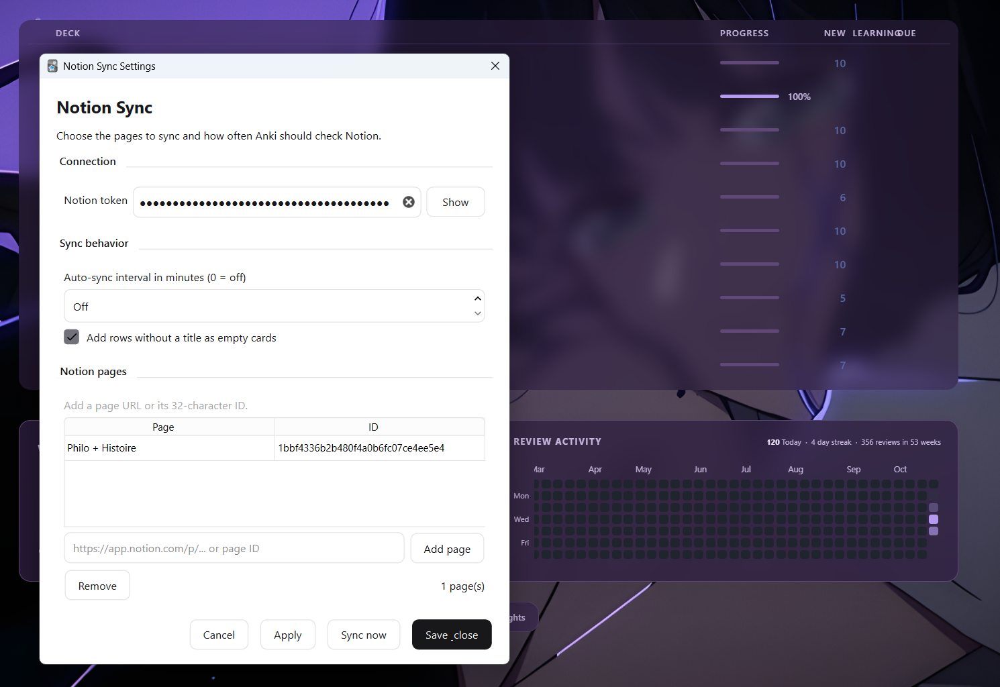
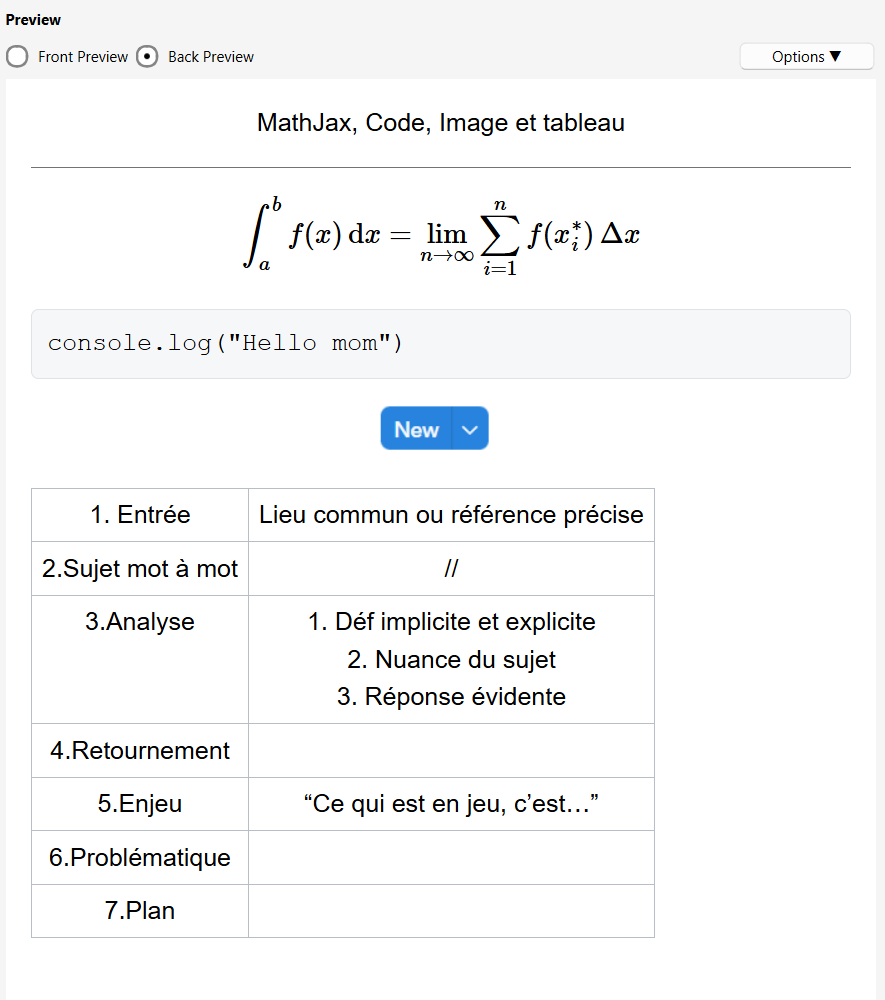
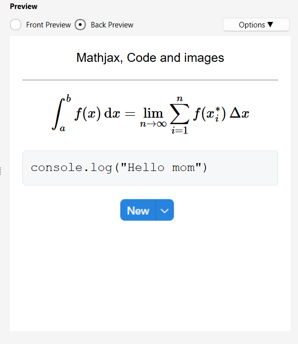

# Anki-Notion Sync

An [Anki](https://apps.ankiweb.net/) add-on that imports Notion pages through
the official Notion API.

## Setup

1. Create a Notion integration at
   https://www.notion.so/my-integrations and share your pages with it.
2. In Anki, open **Tools > Notion Sync > Settings**.
3. Enter the integration token and add each page using its full URL or 32-character ID.
4. Click **Save & close**, then **Sync now**.

Auto-sync is off by default. Set the interval in **minutes**; `0` means off.
Rows without titles are imported as empty-front cards by default and can be
disabled in Settings.



## Notion page structure

Organize your Notion content as a page containing one or more tables. Each
table becomes a subdeck, and each row in a table becomes a card:

```text
Notion page
└── Table
    ├── Row → card
    ├── Row → card
    └── Row → card
```

Use the table's title property for the card front. The rest of the row content
becomes the card back. For example:


Each Notion page becomes a deck, each table becomes a subdeck, and each row
becomes a card. Synced cards are updated or removed when their Notion source
disappears. Decks and manually created cards are never deleted.

Notion content supports formatting, lists, code, MathJax, links, and imported
images, audio, video, and attachments. Cards use Anki's normal styling.

## Contenu pris en charge

Les cartes peuvent contenir :

- des formules **MathJax** ;
- du **code** avec une mise en forme lisible ;
- des **images** importées depuis Notion ;
- des **tableaux** avec bordures et cellules espacées.



## Card preview

The add-on supports formatted MathJax, code, and images in the card preview.
Tables include borders and spacing so their contents remain readable.



## Related project

[Notion Philo Workflow](https://notion-philo-workflow.vercel.app/) complements
this add-on by exporting cards to PDF for printing. Its source is available on
[GitHub](https://github.com/lennon03/notion-philo-workflow).
