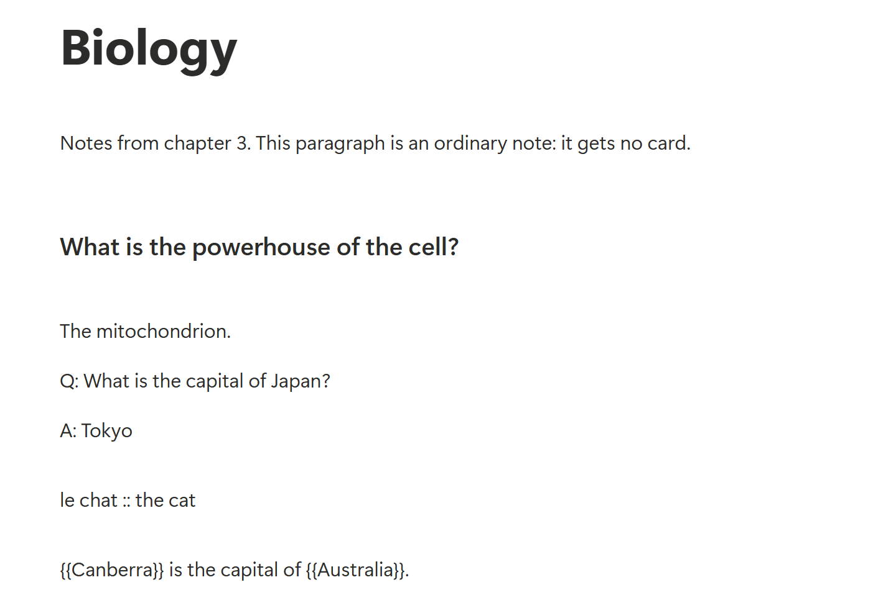
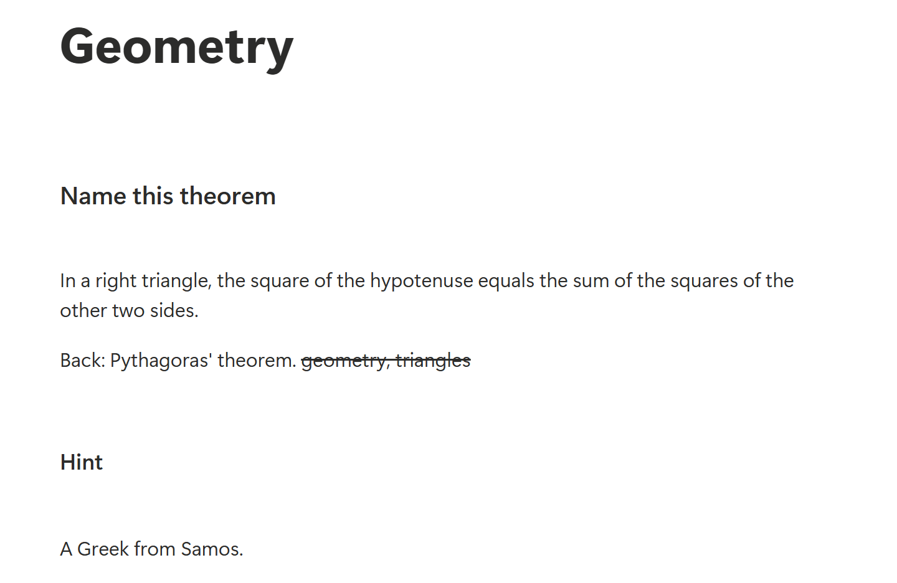

# Notion Sync guide

Write your notes in Notion. Notion Sync turns them into Anki cards and keeps
them up to date. Notion is always the original: you edit there, never in Anki.

- [1. The idea in one minute](#1-the-idea-in-one-minute)
- [2. Set it up](#2-set-it-up)
- [3. Write cards in a page](#3-write-cards-in-a-page)
- [4. Cloze cards](#4-cloze-cards)
- [5. Long questions, hints and tags](#5-long-questions-hints-and-tags)
- [6. Decks: pages and sub-pages](#6-decks-pages-and-sub-pages)
- [7. Tables, for when you need columns](#7-tables-for-when-you-need-columns)
- [8. What a sync does](#8-what-a-sync-does)
- [9. Settings](#9-settings)
- [10. When something looks wrong](#10-when-something-looks-wrong)

## 1. The idea in one minute

You pick one or more Notion pages. Each page becomes an Anki deck. Inside the
page you write cards as ordinary text:

```
### What is the powerhouse of the cell?
The mitochondrion.

Q: What is the capital of Japan?
A: Tokyo

le chat :: the cat

{{Canberra}} is the capital of {{Australia}}.
```

In Notion, the page looks like this:



It gives five cards (the last line makes two). Text that doesn't look like a
card, like the first paragraph, is left alone, so cards and notes can live on
the same page.

## 2. Set it up

**As an Anki add-on** (Anki desktop):

1. Create a Notion integration at <https://www.notion.so/my-integrations> and
   copy its token.
2. In Notion, open each page you want to sync, then **... > Connections** and
   add your integration. Sub-pages are shared with it automatically.
3. In Anki: **Tools > Notion Sync > Settings**. Paste the token and add each
   page by its link.
4. **Save & close**, then **Sync now**.

**Hosted** (keeps AnkiWeb up to date while Anki is closed): see
[hosted-sync.md](hosted-sync.md).

## 3. Write cards in a page

There are four ways to write a card. Mix them freely on one page.

### A heading with the answer under it

A **heading 3** or **heading 4** is a question. What is under it is the
answer.

```
### Why is the sky blue?
Air scatters blue light more than red light.
This is called Rayleigh scattering.
```

- The answer ends at the next heading, at a divider (`---`), at a `Q:` line
  or at a `front :: back` line.
- Heading 1 and heading 2 are never questions. Use them to organise the page.
- A heading with nothing under it is just a title, not a card.

### `Q:` and `A:`

```
Q: What is the capital of Japan?
A: Tokyo
```

- `Question:` and `Answer:` work too (also `Réponse:`). Capitals don't matter.
- The answer continues on the next lines. **An empty line ends the card.**
- You can type both lines in one paragraph with Shift+Enter.

### One line: `front :: back`

```
le chat :: the cat
```

Put a space on both sides of the `::`. Good for vocabulary and short facts.

### A sentence with a hole (cloze)

```
{{Canberra}} is the capital of {{Australia}}.
```

See the next section.

### What is *not* a card

Everything else: plain paragraphs, lists, images, heading 1 and 2, toggles.
If a card you expected is missing, check that the question is a heading 3 or
4, or that the `Q:` has an `A:` before the next empty line.

## 4. Cloze cards

A cloze hides part of a sentence. Wrap what should be hidden in double
braces:

```
{{Canberra}} is the capital of {{Australia}}.
```

Each pair of braces becomes its own card: one asks for *Canberra*, one for
*Australia*. They are numbered for you, in reading order.

| You write | You get |
| --- | --- |
| `{{Paris}}` | A hole, numbered automatically. |
| `{{Paris::a city}}` | A hole that shows the hint *a city*. |
| `{{c1::Paris}} is in {{c1::France}}` | Anki's own syntax: you choose the number. Holes with the same number are hidden together, on one card. |

A cloze works in a paragraph, a list item, a quote or a callout. **One block
is one note.** To keep several lines together in one note, put them under a
heading:

```
### The French Revolution
It began in {{1789}} with the storming of the {{Bastille}}.
The king was executed in {{1793}}.
```

Text in `inline code` or in a code block is never turned into a cloze.

A page with the cloze forms of this section:

![A Notion page with a cloze line ending in [hide], a cloze under a heading and a numbered list](img/notion-cloze.png)

### Show or hide the other holes

By default, a card hides one hole and **shows the other answers**. That is
Anki's normal behaviour.

To keep **every other hole hidden too** (so nothing gives the answer away),
write `[hide]` at the end of the line or of the heading:

```
{{Paris}} is in {{France}}, {{Rome}} is in {{Italy}}. [hide]
```

On each card you see one `[...]` to answer; the other holes are greyed out.
The back shows everything.

### A list to recite

If the answer under a heading (or after `A:`) is a **numbered list**, you get
one card per item. Each card hides one item and shows the ones before it, so
you learn the list in order.

```
### Phases of mitosis
1. Prophase
2. Metaphase
3. Anaphase
4. Telophase
```

Options go in square brackets after the question:

| Write | Meaning |
| --- | --- |
| `### Steps [2/1]` | Show 2 items before and 1 after the hidden one. The rest is hidden. `[0/0]` shows only the hole. |
| `### Steps [x2]` | Hide 2 items at a time. |
| `### Steps [2/1 x2]` | Both. |
| `### Poem [overlap]` | Recite it line by line even though it is not a numbered list. |
| `### Steps [basic]` | Don't split it: one ordinary card with the whole list on the back. |

## 5. Long questions, hints and tags

### Put more on the front

Normally the front of the card is only the question line. To show more on
the front (a text to read, a picture, some code), write a line that starts
with `Back:`. Everything **above** it goes on the front, everything after it
is the answer.

```
### Name this theorem
In a right triangle, the square of the hypotenuse equals
the sum of the squares of the other two sides.
Back: Pythagoras' theorem.
```

`Answer:` and `Réponse:` work the same way. Without such a line, the front
stays short.



Here the front is the heading and the paragraph, the back is *Pythagoras'
theorem.* with a collapsed hint, and the card gets the tags
`Notion::geometry` and `Notion::triangles`.

With `Q:` and `A:` you don't need it: what you put between the `Q:` line and
the `A:` line is on the front.

```
Q: What does this print?
(a code block here)
A: 6
```

### A hint

A heading 4 called **Hint** starts a collapsed section on the back. It ends
at a divider (`---`) or at the end of the card.

```
### Who wrote the Critique of Pure Reason?
Immanuel Kant
#### Hint
A philosopher from Königsberg.
```

### Tags

**Strike through** a word in a card to make it an Anki tag. The struck text
is removed from the card. `~~biology, cells~~` gives the tags
`Notion::biology` and `Notion::cells`. Use `::` for a hierarchy
(`~~science::biology~~`).

Only tags under `Notion::` are managed. Tags you add by hand in Anki stay.

## 6. Decks: pages and sub-pages

- Each page you add in the settings is a **deck**, named after the page.
- A **sub-page** inside it is a **subdeck**, and so on (up to 5 levels).
  `Biology` with the sub-pages `Cells` and `Genetics` gives the decks
  `Biology`, `Biology::Cells` and `Biology::Genetics`.
- Rename a page in Notion and its cards move to the renamed deck. Cards you
  moved to another deck yourself stay where you put them.

You only add the top page in the settings. New sub-pages are found on the
next sync.

## 7. Tables, for when you need columns

A Notion table (database) on a synced page works too. Use one when you want
columns: a checkbox to choose which rows sync, or your own note type with
extra fields.

- The table is a subdeck of its page. Each **row** is a card.
- The row's **title** is the front. The **page inside the row** is the back.
- Sections 4 and 5 work inside a row too: cloze braces, the `Back:` line,
  `#### Hint` and strikethrough tags. Options are not written in brackets
  here: they go in the `Card type` column.

Optional columns:

| Column | Type | What it does |
| --- | --- | --- |
| `Anki` | Checkbox | Unticked rows get no card. Unticking a row that has a card suspends the card. It is not deleted. |
| `Card type` | Select | `Basic`, `Cloze`, `Cloze hide`, or `Overlapping` (with the same options as the lists above: `Overlapping 2/1 x2`). |

In **Settings > Note types** you can give a table your own Anki note type:
the first field gets the title, the second the page, and a field named like
a Notion column gets that column's text.

## 8. What a sync does

- **Notion wins.** A synced card edited in Anki is overwritten at the next
  sync. Edit in Notion.
- **Edit a card's text** in Notion: the same Anki note is updated. Your
  review history is kept.
- **Delete** the question in Notion: the note is removed from Anki.
- **Your own cards are never touched**, nor are your decks.
- If Notion can't be reached, nothing is deleted. The sync finishes what it
  can and tries the rest next time.
- A sync that changes cards is one undo step: **Edit > Undo Notion Sync**.

A card belongs to the Notion block of its question (the heading, the `Q:`
line, the cloze line). Rewording it is fine. Deleting it and typing it again
makes a new card with no history. To reorder cards, drag the blocks.

## 9. Settings

In Anki: **Tools > Notion Sync > Settings**.

| Setting | What it does |
| --- | --- |
| Token, pages | Which Notion pages are read. |
| Sync every N minutes | Automatic sync. `0` is off. |
| Anki's Sync button also syncs Notion | One button for both. |
| Card style | Classic, T3 Ocean, Minimal, or keep your own CSS. |
| Note types | Your own note type for a table. |

A few more are in the add-on's **Config** (JSON):

| Key | Default | Meaning |
| --- | --- | --- |
| `page_cards` | `true` | Read cards written in pages. |
| `sub_pages` | `true` | Read sub-pages as subdecks. |
| `include_empty_cards` | `true` | Rows without a title become cards with an empty front. |
| `sync_column` | `"Anki"` | Name of the checkbox column. Empty turns it off. |
| `card_type_column` | `"Card type"` | Name of the card type column. |

Details of the sync, the cache and the edge cases are in the
[add-on reference](../notion_sync_addon/config.md).

## 10. When something looks wrong

| You see | Check |
| --- | --- |
| A card is missing | Is the question a heading 3 or 4? Does the `Q:` have an `A:` before an empty line? Is there a space on both sides of `::`? |
| The whole page gives nothing | Is the page shared with your integration (**... > Connections**)? |
| A heading became a card but is only a title | Put nothing under it, or make it a heading 1 or 2. |
| A numbered list was split into several cards | Add `[basic]` after the question. |
| `{{something}}` became a cloze by accident | Format it as inline code. |
| A recited list shows every line on a phone | It needs a recent browser engine (CSS `:has`). Update AnkiDroid and Android System WebView. |
| A warning after a sync | **Settings** lists what the last sync could not read. Nothing was deleted because of it. |
